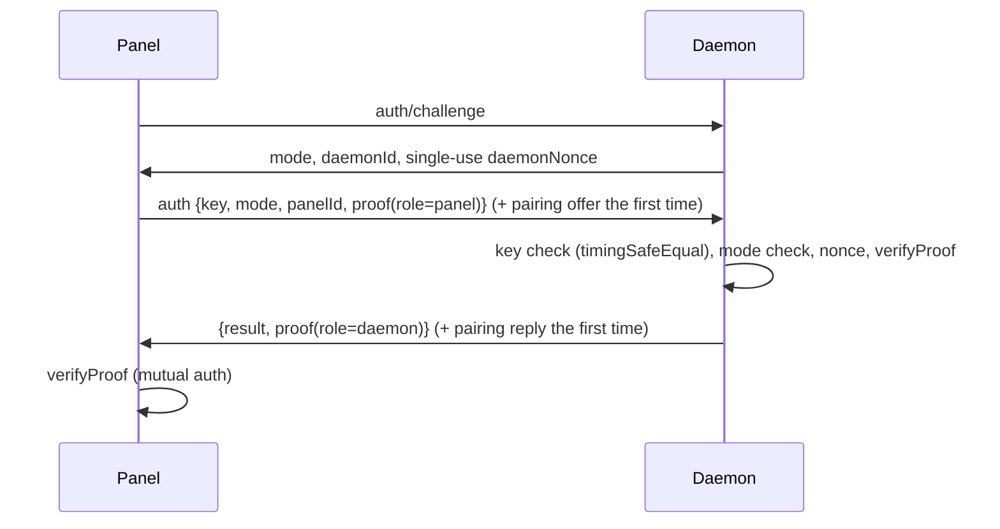

# Panel/daemon passport authentication

## 1. Overview
An extra authentication layer between panel and daemon, on top of upstream's daemon key check (which already uses `timingSafeEqual` and an optional panel IP allow-list). It brings over the design from the Johnnykins-MCSManager fork: both sides hold their own secret/salt pair and a session is trusted only when both pairs prove it. Two modes are available, selected by config:

| Mode | What it is | When to use |
|---|---|---|
| `standard` (default) | HKDF-SHA256 key from both secret pairs, HMAC-SHA256 challenge-response, nonces, freshness window, replay cache | Recommended; uses only NIST-approved primitives |
| `johnnykins-legacy` | The original `JohnsNonAsymmSha256Wrapper` (three HMAC links + seeded scramble + entropy multiplier) and passport types 1-4, with the security fixes below | When you want the original algorithm |
| `off` | Upstream behaviour only | Debugging |

Status: wired into the daemon (`daemon/src/service/johnnykins/passport_auth.ts`, `routers/auth_router.ts`) and the panel (`panel/src/app/service/johnnykins/passport_client.ts`). Live-tested 2026-10-25: pairing, 4/4 standard reconnects, 6/6 legacy reconnects, and refusal of bare keys, missing challenges, wrong keys and a second panel.

## 2. How it works
Everything runs over the existing socket.io connection (`common/src/passport/handshake.ts`).

`K = HKDF-SHA256(panelSecret || daemonSecret, panelSalt || daemonSalt, "mcsm-passport-v1")`. The transcript is length-prefixed and includes the role, so a proof cannot be reflected back.

**Pairing** (the fork's `lock` and `daemon-sync`): the first panel that shows the right daemon key while the daemon's `lock` is `false` sends its secret pair; the daemon stores it, sends its own pair back and sets `lock` to `true`. That one round is trusted on the daemon key alone (trust on first use), so pair over TLS or on localhost. After that, a locked daemon never sends its pair again.

**Legacy mode** keeps the original verification call: the daemon fingerprints each passport field with `JohnsNonAsymmSha256Wrapper` and asks the panel at `legacy.panelServerAddress` (`GET /api/auth/daemon-verifications`) whether it issued that passport.

### Why connections sometimes failed in the fork
Found while porting the newer fork source (2026-10-25), and fixed:

| Cause | Effect | Fix |
|---|---|---|
| `LimitedLRUArray.add()` used `this.data.size` as the key | After any passport expired, the next one overwrote another daemon's live passport, so that daemon failed verification. Reproduced. | `LegacyPassportStore` with unique ids |
| The passport list held only 5 entries | A panel restart with 5+ nodes evicted passports still in flight. Reproduced with 6. | Bound of 256 with a 60 s TTL |
| Panel hashed passports with the wrapper; daemon used plain `generateToken` for types 1-3 | Passport types 1-3 could never verify | Both sides call `legacyFingerprint()` |
| Daemon set `lock = true` even when `daemon-sync` failed | If the panel wasn't listening yet, the daemon locked itself with no panel secrets | Lock only after both pairs are stored |
| No timeout on the daemon's verification call; banned branch returned no body | A slow panel held the socket until the auth timer cut it | `verifyTimeoutMs`, always a JSON body |
| SQLite ban DB: missing tables on an existing file, a close/reopen race, a new connection per event | Every event could throw while the DB was being set up | In-memory ban list with atomic saves |
| Config read into module constants before `load()` | First run used defaults instead of your config | Settings read at call time |
| Mode/type mismatch looked like a generic failure | Hard to diagnose | Explicit `mode_mismatch` and other reasons in both logs |

## 3. How it is secure
| Control | Standard |
|---|---|
| HMAC-SHA256, HKDF via node:crypto (OpenSSL, FIPS-capable) | NIST SC-13, SP 800-108/RFC 5869 |
| CSPRNG nonces and secrets (`randomBytes`, `randomInt`) | CWE-330/338 |
| Constant-time compare on equal-length digests | CWE-208 |
| Single-use daemon nonce, freshness window (5 min for clock skew), bounded replay cache | CWE-294, CWE-400 |
| Strict input validation, fail closed | CWE-20 |
| Secrets never logged | CWE-532, NIST AU-9 |

Fixes applied to the legacy algorithm (details in `docs/SECURITY-LOG.md`): regex comparisons replaced by `timingSafeEqual` (closed a `.*` auth bypass), Math.random replaced by `crypto.randomInt`, utf8-decoded random bytes replaced by base64url.

## 4. How to use it
1. Leave both sides on `standard` (the default) and add the daemon in the panel as usual. Pairing happens on the first connection.
2. To use the original algorithm, set `johnnykins.passport.mode` to `"johnnykins-legacy"` on both the daemon and the panel, set `legacy.panelServerAddress` on the daemon, set `lock` to `false` on the daemon and restart both.
3. To pair a different panel, set the daemon's `lock` to `false` and restart it.

Settings: [daemon](../configuration/daemon-johnnykins.md), [panel](../configuration/panel-johnnykins.md).

## 5. Dependencies
| Package | Version | Purpose | CVE check |
|---|---|---|---|
| node:crypto | runtime | HMAC, HKDF, CSPRNG | n/a |
| seedrandom | 3.0.5 | Legacy scramble only (keyed shuffle, not used for secrets) | npm audit 2026-10-25: no advisory for seedrandom |

## 6. Limitations and known risks
- Legacy scramble is a non-approved construction (accepted risk, documented).
- The fork's IP-ban database keyed on `X-Forwarded-For`/Cloudflare headers is not ported as-is because those headers are client-spoofable; bans key on the socket address, or on `X-Forwarded-For` only from configured `trustedProxies`.
- Pairing trusts the daemon key for one round. Upstream MCSManager connects to `wss://` daemons with `rejectUnauthorized: false` (TLS not verified); see SECURITY-LOG.
- Upstream panels (bare-key login) can only connect to a daemon in `off` mode.
- The fork's PandorasWall and file-hash tamper checks are not ported: the Symbol comparison in `setExpressApp` can never succeed (each `Symbol()` is unique), and a hash file stored next to the code it protects can be replaced together with it. Signed releases and read-only deployment (SLSA, CIS) are the recommended replacement.

## 7. Troubleshooting
| Symptom | Cause |
|---|---|
| `mode_mismatch (panel=…, daemon=…)` | Set the same `johnnykins.passport.mode` on both sides |
| `locked_to_other_panel` / `repair_requires_unlock` | The daemon is paired with another panel, or this panel lost its pairing. Set the daemon's `lock` to `false` and restart it |
| `no_challenge` | Daemon is an upstream build, your address is banned, or the panel IP allow-list blocks it |
| `bad_proof` / `bad_daemon_proof` | Clock skew over 5 min, or a pairing copied by hand is wrong; unlock and re-pair |
| `legacy_verify_failed` | Daemon can't reach `legacy.panelServerAddress`, or passport types differ |
| `Invalid panel secret` | Secret is not base64url or shorter than 32 bytes; regenerate with `generateSecretPair()` |
