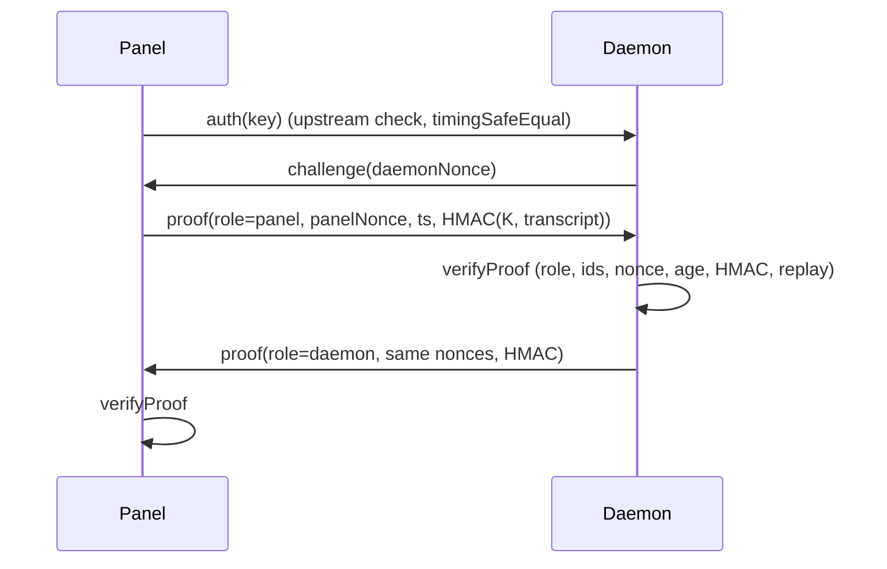

# Panel/daemon passport authentication

## 1. Overview
An extra authentication layer between panel and daemon, on top of upstream's daemon key check (which already uses `timingSafeEqual` and an optional panel IP allow-list). It brings over the design from the Johnnykins-MCSManager fork: both sides hold their own secret/salt pair and a session is trusted only when both pairs prove it. Two modes are available, selected by config:

| Mode | What it is | When to use |
|---|---|---|
| `standard` (default) | HKDF-SHA256 key from both secret pairs, HMAC-SHA256 challenge-response, nonces, freshness window, replay cache | Recommended; uses only NIST-approved primitives |
| `johnnykins-legacy` | The original `JohnsNonAsymmSha256Wrapper` (three HMAC links + seeded scramble + entropy multiplier) and passport types 1-4, with the security fixes below | When you want the original algorithm |
| `off` | Upstream behaviour only | Debugging |

Status: library done and tested (`common/src/passport/`). Wiring into `daemon/src/routers/auth_router.ts` and the panel's remote service connection is the next step.

## 2. How it works (standard)

`K = HKDF-SHA256(panelSecret || daemonSecret, panelSalt || daemonSalt, "mcsm-passport-v1")`. The transcript is length-prefixed and includes the role, so a proof cannot be reflected back.

## 3. How it is secure
| Control | Standard |
|---|---|
| HMAC-SHA256, HKDF via node:crypto (OpenSSL, FIPS-capable) | NIST SC-13, SP 800-108/RFC 5869 |
| CSPRNG nonces and secrets (`randomBytes`, `randomInt`) | CWE-330/338 |
| Constant-time compare on equal-length digests | CWE-208 |
| 60 s freshness window + single-use nonce cache (bounded) | CWE-294, CWE-400 |
| Strict input validation, fail closed | CWE-20 |
| Secrets never logged | CWE-532, NIST AU-9 |

Fixes applied to the legacy algorithm (details in `docs/SECURITY-LOG.md`): regex comparisons replaced by `timingSafeEqual` (closed a `.*` auth bypass), Math.random replaced by `crypto.randomInt`, utf8-decoded random bytes replaced by base64url.

## 4. How to use it (library)
```ts
import { standardPassport as S } from "mcsmanager-common";
const keys = { panel: S.generateSecretPair(), daemon: S.generateSecretPair() };
const daemonNonce = S.generateNonce();                       // daemon side
const proof = S.createProof(keys, { role: "panel", panelId, daemonId, daemonNonce, panelNonce: S.generateNonce() });
S.verifyProof(keys, proof, { expectedRole: "panel", panelId, daemonId, expectedNonce: { daemonNonce }, nonceCache });
```
Configuration keys (planned for panel `data/SystemConfig/config.json` and daemon `data/Config/global.json`) will be documented in `docs/configuration/` when wired in: `passportMode`, `passportSecret`, `passportSalt`, and for legacy mode `passportType` (1-4) and `tokenEntropyMax` (1-10). Secrets must come from the config file with 0600 permissions or environment variables, never from the repo.

## 5. Dependencies
| Package | Version | Purpose | CVE check |
|---|---|---|---|
| node:crypto | runtime | HMAC, HKDF, CSPRNG | n/a |
| seedrandom | 3.0.5 | Legacy scramble only (keyed shuffle, not used for secrets) | npm audit 2026-10-25: no advisory for seedrandom |

## 6. Limitations and known risks
- Legacy scramble is a non-approved construction (accepted risk, documented).
- The fork's IP-ban database keyed on `X-Forwarded-For`/Cloudflare headers is not ported as-is because those headers are client-spoofable; bans will key on the socket address or a configured trusted proxy (upstream `proxy_addr.ts`).
- The fork's PandorasWall and file-hash tamper checks are not ported: the Symbol comparison in `setExpressApp` can never succeed (each `Symbol()` is unique), and a hash file stored next to the code it protects can be replaced together with it. Signed releases and read-only deployment (SLSA, CIS) are the recommended replacement.

## 7. Troubleshooting
| Symptom | Cause |
|---|---|
| `verifyProof` returns false | Clock skew > 60 s, wrong secret pair on one side, nonce mismatch, or replayed proof |
| `Invalid panel secret` | Secret is not base64url or shorter than 32 bytes; regenerate with `generateSecretPair()` |
