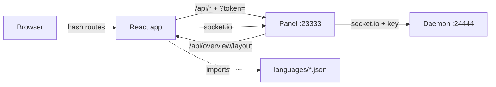

# React frontend (`frontend-react/`)

## 1. Overview
A rewrite of the MCSManager web UI from Vue 3 to React 19 that looks and behaves like upstream. It is a drop-in client: the panel, daemon (including Docker support), API, saved layouts and translation files are unchanged, so the React and Vue UIs can run against the same panel during the port.

## 2. How it works

| Upstream (Vue) | React port |
|---|---|
| pinia / `createGlobalState` stores | zustand stores in `src/stores` |
| vue-router hash history + `beforeEach` | react-router `HashRouter` + `resolveNavigation()` in `src/config/routes.ts` |
| vue-i18n | i18next with `{name}` placeholders, same JSON files |
| ant-design-vue 4 | antd 6 (same design system) |
| `LAYOUT_CARD_TYPES` Vue components | `src/config/widgets.tsx` registry |
| scoped SCSS | same SCSS copied into per-component `.scss` files, class names unchanged |

Boot order matches `main.ts`: panel status, language, layout config, then lazy-load and mount.

**Parity rules:** copy class names and SCSS verbatim; keep API calls and payloads identical; keep translation keys; compare each ported screen against the Vue UI with screenshots before marking it done.

### Port phases
| Phase | Scope | Status |
|---|---|---|
| 0 | Shell, header, breadcrumbs, routing, layout grid, i18n, theme, API client, install, login | done |
| 1 | Sidebar layout, phone bottom nav, design mode (drag/drop, card operator, new-card dialog), MyselfInfoDialog, overview/status/chart widgets, instance and node lists | done: shell, design mode, profile dialog, Overview, Daemons, Instances, My Application and Open Page |
| 2 | Next. Instance console: xterm terminal, controls, file manager, schedules, server config, mods, Docker options in instance settings | |
| 3 | Admin: settings (done early, with the Daemon Passport pane), users, permissions, images (Docker), audit log, market and quick start | |
| 4 | Decorative cards (image, iframe, text, link, clock, carousel, music, plugin), cutover: replace `frontend/`, update build scripts | |

`PORT_STATUS` in `src/config/widgets.tsx` tracks every widget type.

## 3. How it is secure
Threat model: the UI is a client of an authenticated panel. Attacker inputs are panel data authored by other users (layout JSON, login Markdown, SSO icon URL, background URL, instance output) and URL parameters.
- Authorization stays server-side; the route guard only hides pages (ASVS V4.1.1, NIST AC-3).
- React escapes all text; the only HTML sink is admin Markdown, sanitized by DOMPurify allow-list with URL scheme filtering and `rel="noopener noreferrer"` (CWE-79, ASVS V5.3.3).
- Layout JSON is validated, and only statically registered widget types render (CWE-20).
- CSS background URLs are scheme-checked and escaped (CSS injection).
- No inline script in `index.html`, so a strict CSP is possible (ASVS V14.4.3).
- Dev server host allow-list (CWE-350); hidden production sourcemaps (CWE-540).
- Errors show messages only, never stacks (CWE-209).
- Known carry-over: the panel reads its anti-CSRF token from `?token=` (CWE-598 risk in proxy logs); see TODO in `src/services/apiService.ts`.

## 4. How to use it
```bash
# from the repo root, with a panel running on :23333
cd frontend-react
npm ci
npm run dev          # http://localhost:5173, proxies /api and /socket.io to the panel
npm test             # unit + security tests
npm run build        # type-check + production bundle in dist/
```
Point at another panel with `MCSM_PANEL_URL=http://host:23333 npm run dev`.

## 5. Dependencies
Checked with `npm audit` on 2026-10-25: 0 vulnerabilities. All versions pinned exactly in `package.json` with `package-lock.json` integrity hashes.

| Package | Version | Purpose |
|---|---|---|
| react, react-dom | 19.3.1 | UI runtime |
| antd, @ant-design/icons | 6.6.7, 6.3.4 | Same design system as ant-design-vue |
| react-router | 7.18.4 | Hash routing |
| zustand | 5.0.16 | Global stores |
| i18next, react-i18next | 26.5.10, 17.1.8 | Translations |
| axios | 1.20.0 | HTTP client (same as upstream) |
| eventemitter3 | 5.0.4 | Request de-duplication (same as upstream) |
| marked, dompurify | 18.1.1, 3.4.17 | Safe Markdown |
| dayjs | 1.11.23 | Dates (same as upstream) |
| pretty-bytes | 7.2.0 | Byte formatting (same as upstream) |
| echarts | 6.1.0 | Charts (upstream uses 5.x, which has GHSA-fgmj-fm8m-jvvx) |
| vite, @vitejs/plugin-react, typescript, sass, vitest, jsdom | 8.3.5, 6.1.2, 7.0.2, 1.106.1, 5.0.5, 30.1.3 | Tooling (dev only) |

## 6. Limitations and known risks
- Most widgets still show the "not ported" card (see phases).
- jsdom 30 warns that it wants Node >= 22.22.2 (tests still pass on 22.22.0).

## 7. Troubleshooting
| Symptom | Fix |
|---|---|
| Loading screen shows "backend is currently unavailable" | Panel not running or `MCSM_PANEL_URL` wrong |
| Every card says "not ported" | Expected for unported widgets; use the Vue UI for those pages meanwhile |
| Dev server rejects your hostname | Add it to `VITE_DEV_ALLOWED_HOSTS` (comma separated) |
